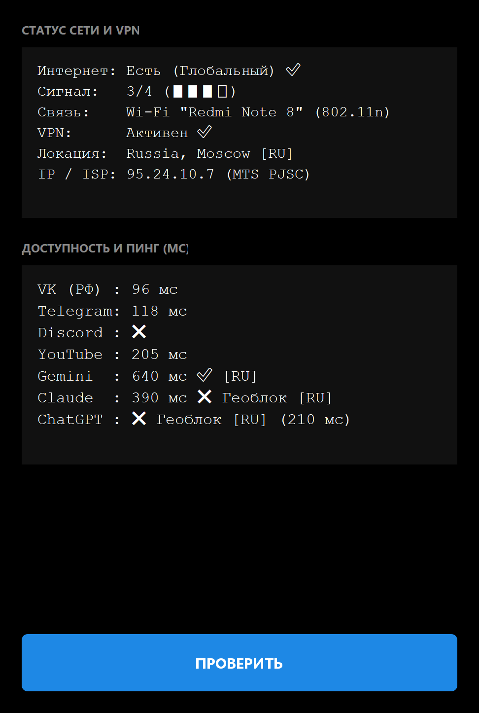

# Net & VPN Checker (Desktop)

Десктопный порт Android-приложения **AnalysePing** на Windows: проверка сети, VPN,
определение локации по IP и доступности сервисов (VK, Telegram, Discord, YouTube,
Gemini, Claude, ChatGPT).

Написано на **Java 21 + Swing**, без внешних зависимостей. Собирается либо в
обычный `.jar`, либо в **автономный `NetCheck.exe`** со встроенной Java —
на другом компьютере ничего устанавливать не нужно.



## Возможности

- **Статус сети:** интернет, сигнал Wi-Fi (полосы), SSID и тип радио, VPN.
- **Локация:** быстрая через Cloudflare `1.1.1.1/cdn-cgi/trace`, подробная через `ipwho.is`
  (страна, город, IP, провайдер).
- **7 сервисов параллельно** с пингом в миллисекундах и мгновенным обновлением строк.
- **Детект геоблокировки:** Gemini (`vXmutd`), Claude и ChatGPT (Cloudflare trace),
  плюс список заблокированных стран (RU, BY, CN, HK, IR, KP, SY, CU).
- **Диагноз:** «Есть (Глобальный)», «Только Белый список РФ», «Нет связи».
- **Трей вместо плитки:** иконка меняет цвет по результату, клик открывает окно,
  меню умеет запустить проверку и выйти.
- **Один экземпляр:** повторный запуск просто показывает уже открытое окно.
- **Устойчивость к разовым сбоям:** если сервис не ответил, приложение делает один
  повтор (Claude/ChatGPT — после паузы 2 с, остальные — после 0.4–1.2 с).
  Gemini не повторяется, чтобы реальная блокировка не растягивала проверку.
- **Доверие к сертификатам Windows:** если антивирус инспектирует HTTPS
  (Kaspersky и т.п.), проверки не ломаются с `PKIX path building failed`.

## Готовый EXE

На Рабочем столе лежит ярлык **NetCheck** и папка **NetCheck** с портативной сборкой:

```
Рабочий стол/
├─ NetCheck.lnk          — ярлык
└─ NetCheck/
   ├─ NetCheck.exe       — запуск
   ├─ runtime/           — встроенная Java (ничего ставить не нужно)
   └─ app/               — NetCheck.jar и конфиг
```

Папку `NetCheck` можно скопировать на флешку или другой ПК с Windows 10/11 —
она полностью автономна. Ярлык при этом нужно создать заново.

## Сборка

### Обычный jar

```bat
build.cmd
run.cmd
```

`build.cmd` компилирует исходники и создаёт `NetCheck.jar`.
`run.cmd` запускает его без консольного окна (`javaw`).

### Автономный EXE

```bat
package.cmd
```

Создаёт `dist\NetCheck\NetCheck.exe` со встроенной Java (~71 МБ).
Затем можно разложить на Рабочий стол:

```bat
powershell -ExecutionPolicy Bypass -File deploy-desktop.ps1
```

`package.cmd` находит `jpackage.exe` в JDK автоматически. Для запуска
готового EXE Java на компьютере **не требуется**.

Если что-то падает — `debug.cmd` запускает jar с консолью и показывает ошибки.

## Управление

| Действие | Что делает |
|---|---|
| Кнопка **ПРОВЕРИТЬ** / **F5** / **Ctrl+R** | Запускает диагностику |
| **Esc** или крестик | Сворачивает окно в трей |
| Клик по иконке в трее | Открывает окно |
| Меню трея → «Проверить сейчас» | Проверка в фоне + всплывающее уведомление |
| Меню трея → «Выход» | Полностью закрывает приложение |

## Соответствие Android-версии

| Android | Desktop |
|---|---|
| `MainActivity` + layout | `App.java` (Swing, та же тёмная тема) |
| `checkService()` и проверки | `Checks.java` (те же URL, таймауты, правила) |
| Параллельные корутины | `CheckSession.java` (`ExecutorService`) |
| `NetCheckTileService` (плитка) | `TrayManager.java` (иконка в трее) |
| `ConnectivityManager` / `WifiManager` | `SystemInfo.java` (`netsh` + `NetworkInterface`) |
| Разрешения `READ_PHONE_STATE`, `LOCATION` | Не нужны |

## Отличия от Android-версии

- **Мобильной сети нет** — вместо 2G/3G/4G/5G показывается Wi-Fi или Ethernet.
- **Сигнал Wi-Fi** берётся из процента `netsh` и переводится в 0–4 полосы
  (≥80% — 4, ≥60% — 3, ≥40% — 2, ≥20% — 1). Для провода показывается 4/4.
- **VPN** определяется по именам сетевых адаптеров (WireGuard, OpenVPN, Radmin,
  Hamachi, Happ, Wintun, TAP, Tailscale, ZeroTier и т.п.). Список шаблонов —
  в `SystemInfo.java`.
- Таймауты подобраны под десктоп: **Gemini 15 с**, **Cloudflare-сервисы 6 с**,
  **обычные 4.5 с**. При сбое (кроме Gemini) делается один повтор с коротким
  таймаутом; явные геоблокировки не повторяются.
- Плитки быстрых настроек нет — её заменяет трей.

## Консольные режимы

```bat
rem Проверка без окна, результат в UTF-8-файл
java -jar NetCheck.jar --test result.txt

rem То же самое через готовый EXE
dist\NetCheck\NetCheck.exe --test result.txt

rem Отрисовка окна с демо-данными в PNG
java -jar NetCheck.jar --screenshot shot.png

rem Подробные причины и тайминги сбоев (в stderr)
java -Dnetcheck.debug=true -jar NetCheck.jar --test result.txt
```

Удобно для отладки и проверки вёрстки без запуска GUI.

## Структура

```
NetCheck/
├─ src/netcheck/
│  ├─ Main.java          — точка входа, консольные режимы
│  ├─ App.java           — окно, кнопка, горячие клавиши
│  ├─ CheckSession.java  — параллельный прогон проверок и текст экрана
│  ├─ Checks.java        — HTTP-проверки сервисов и локации
│  ├─ SystemInfo.java    — Wi-Fi/Ethernet/VPN через ОС
│  ├─ TrayManager.java   — иконка и меню в трее
│  ├─ SingleInstance.java— защита от второго экземпляра
│  ├─ SslTrust.java      — доверие к хранилищу сертификатов Windows
│  ├─ Icons.java         — рисуемые иконки
│  └─ Theme.java         — палитра и шрифты
├─ build.cmd             — сборка jar
├─ package.cmd           — сборка автономного app-image (exe)
├─ deploy-desktop.ps1    — копирование на Рабочий стол + ярлык
├─ run.cmd / debug.cmd
├─ app.ico               — иконка приложения и exe
├─ NetCheck.jar
└─ preview.png
```

## Настройка

- **Список сервисов и URL** — `Checks.TARGETS`.
- **Заблокированные страны** — `Checks.BLOCKED`.
- **Таймауты и повторы** — `Checks.checkService()` и `Checks.initialTimeout()`.
- **Шаблоны VPN-адаптеров** — `SystemInfo.VPN`.
- **Цвета и шрифты** — `Theme.java`.

## Известные ограничения

- Для Wi-Fi нужна служба **WLAN AutoConfig** и адаптер с драйвером; иначе
  `netsh wlan show interfaces` ничего не вернёт, но Ethernet-режим продолжит работать.
- Антивирус с HTTPS-инспекцией (Kaspersky и др.) иногда придерживает новые
  TLS-соединения и показывает свои уведомления. Приложение доверяет корневым
  сертификатам Windows и повторяет такие проверки автоматически, поэтому
  ложных «❌» стало заметно меньше. Если уведомления антивируса мешают, добавьте
  `claude.ai`, `chatgpt.com`, `gemini.google.com` (или сам `NetCheck.exe`)
  в его исключения.
- Короткие провалы маршрута до Cloudflare через VPN могут на несколько секунд
  «ронять» сразу Claude, ChatGPT и определение локации — это сеть, а не приложение;
  повторная проверка обычно проходит.
- При реальной блокировке обычного сервиса (Discord, YouTube и т.п.) проверка
  может занять до ~10 секунд из-за одной повторной попытки.
- Порт **48765** используется для «один экземпляр»; если он занят другим
  приложением, запустится второй экземпляр.
- `jar` и `jpackage` не нужны для запуска, но `build.cmd`/`package.cmd` сами
  находят их в JDK, даже если их нет в `PATH`.

## Идеи на потом

- Автозапуск с Windows и глобальная горячая клавиша.
- Тёмный заголовок окна (DWM) и установщик через `jpackage --type exe`.
- История проверок и график пинга.
